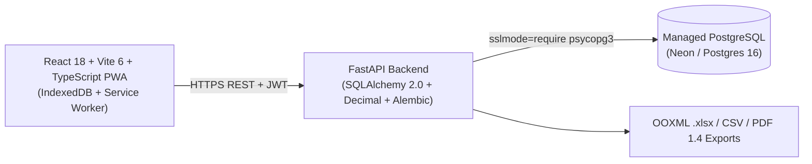

# FactoryFlow — Order-to-Audit Manufacturing ERP

**Order-to-Audit Manufacturing ERP connecting sales, GST billing, BOM-based production, inventory, costing, audit reporting, and offline PWA order synchronization.**

---

## 1. Project Overview
FactoryFlow is a production-grade ERP prototype tailored for Indian food & snack manufacturers. It enforces full batch-to-invoice financial and inventory traceability from supplier procurement and multi-version BOM manufacturing through state-aware GST invoicing, dispatch, customer payments, executive reporting, and offline field sales capture.

## 2. Problem Statement
Small and mid-sized manufacturing plants struggle with disconnected spreadsheets across floor production, raw material wastage, GST calculations, customer receivables, and field salesmen working in low-connectivity zones—resulting in inventory drift, uncosted wastage, duplicate orders, and non-reconciled audits.

## 3. Architecture Diagram


## 4. Technology Stack
- **Frontend**: React `18.3.1`, TypeScript `5.6.3`, Tailwind CSS `3.4`, Vite `6.4.6` (`Node >= 20.18.0`), Vitest `2.1.9`, custom Service Worker + IndexedDB (`factoryflow_offline_db`).
- **Backend**: Python `3.13`, FastAPI `0.115.6`, SQLAlchemy `2.0.36`, Alembic `1.14.0`, Pydantic v2 (`Decimal` & PostgreSQL `NUMERIC`), `psycopg[binary] 3.2.3`, bcrypt `4.2.1`, PyJWT `2.10.1`.
- **Cloud Targets**: Vercel (Frontend SPA + PWA), Render (FastAPI + Docker/Python), Neon (Managed PostgreSQL).

## 5. User Roles & Permissions
| Role | Internal Key | Access Scope |
| :--- | :--- | :--- |
| **Factory Admin / Owner** | `admin` | Full governance, Owner Dashboard, approvals, GST invoicing, dispatches, adjustments |
| **Order & Production Manager (Salesman)** | `order_manager` | Assigned customers only, quick Mobile & Offline PWA orders, own order tracking |
| **Shop Floor Supervisor** | `floor_supervisor` | Purchases, Inventory receipts, Production execution & run expenses |
| **QA Inspector** | `qa_inspector` | BOM verification, production quality & wastage inspection |
| **Compliance Auditor / Accountant** | `auditor` | Strictly read-only Finance/Auditor portals, all 15 audit reports & `.xlsx`/`.csv`/`.pdf` exports |

## 6. Features by Development Phase
- **Phases 1–2 (Core RBAC & Master Data)**: JWT authentication, 5 roles, immutable `audit_logs`, Products (`MUR-200`), Raw/Packaging `StockItem`s, Customers, Suppliers, and dimensional Unit Conversions.
- **Phase 3 (Purchases & Weighted-Avg Inventory)**: Append-only `StockLedger` (`before_update`/`before_delete` guards), `StockBalance`, multi-unit purchase posting/cancellation, negative-stock prevention.
- **Phase 4 (BOM & Production)**: Versioned BOM snapshots, batch scaling, consumed+damaged input issues, good packet output, carton capacity check, and `-/+` tolerance variance engine.
- **Phase 5 (Sales Orders, GST Invoices & Dispatch)**: Mobile order workflow, stock shortage holds (`AWAITING_STOCK`), intra-state `CGST+SGST` vs inter-state `IGST`, immutable GST Tax Invoices & PDFs, atomic dispatches.
- **Phase 6 (Costing, Overheads & Payments)**: Actual weighted-avg material cost + posted expenses (`Labour`, `Gas`, `Power`), pre-GST margin, customer payments, allocation dedup, Customer Ledger/Statement, 5-bucket ageing.
- **Phase 7 (Owner Dashboard & Audit Reporting)**: Owner Console (15 KPIs, 10 trends, alerts), Auditor Portal, 15 audit reports with historical `as_of_date` ledger reconstruction, `.xlsx`/`.csv`/`.pdf` exports.
- **Phase 8 (Offline PWA & Idempotent Sync)**: Web manifest, icons, SW shell cache (`/api/*` bypass), IndexedDB offline queue, auto-sync on launch/`online`, price conflict detection (`NEEDS_REVIEW`), `POST /api/v1/orders/sync` with unique `idempotency_key`.
- **Phase 9–10 (E2E Benchmark QA & Deployment)**: Safety-guarded benchmark reset-and-seed CLI, 103 automated tests, Render/Vercel configs, 2-page PDF design note, submission docs.

## 7. Installation & Local Run Instructions (Docker-Free)

### Backend Setup
```powershell
cd backend
python -m venv .venv
.\.venv\Scripts\python.exe -m pip install -r requirements.txt
Copy-Item .env.example .env   # Configure DATABASE_URL (Neon PostgreSQL) & SECRET_KEY
.\.venv\Scripts\python.exe -m alembic upgrade head
.\.venv\Scripts\python.exe -m scripts.seed --force-demo   # Optional: dummy demo accounts only
.\.venv\Scripts\python.exe -m uvicorn app.main:app --reload --port 8000
```

### Frontend Setup
```powershell
cd frontend
npm install
Copy-Item .env.example .env   # Uses /api/v1 proxy in dev or VITE_API_BASE_URL in production
npm run dev
```

### Optional Docker Compose Alternative
```bash
docker compose up --build
```

## 8. Environment Configuration
- **Backend** ([backend/.env.example](backend/.env.example)): `DATABASE_URL`, `SECRET_KEY` (32+ chars), `ENVIRONMENT`, `CORS_ORIGINS`, `DEMO_SEED_ENABLED`, `DEMO_SEED_PASSWORD`. Never commit `.env`.
- **Frontend** ([frontend/.env.example](frontend/.env.example)): `VITE_API_BASE_URL` (set to deployed Render `/api/v1` URL; never place secrets in `VITE_*` variables).

## 9. Demo Login Accounts (Non-Production Evaluation Only)
When `DEMO_SEED_ENABLED=true`, dummy accounts are provisioned with `DEMO_SEED_PASSWORD` (default `FactoryFlow!2026`):
- Admin: `admin@factoryflow.io` | Owner: `owner@factoryflow.io`
- Salesman A: `orders@factoryflow.io` | Salesman B: `salesman_b@factoryflow.io`
- Supervisor: `floor@factoryflow.io` | QA: `qa@factoryflow.io` | Auditor: `auditor@factoryflow.io`

## 10. Benchmark Seed & Results (Murukku 200 g)
Isolated reset-and-seed command (blocked from executing against production or main `DATABASE_URL`):
```powershell
cd backend
.\.venv\Scripts\python.exe -m scripts.benchmark_reset_seed --database-url sqlite:///./.benchmark_test_isolated.db
```
Verified benchmark outputs (`Murukku 200 g`, selling price `₹50`, GST `5%`):
- **Flour**: `100 kg @ ₹42` + `60 kg @ ₹45` -> `160 kg @ ₹43.125/kg` (`₹6,900`); after `40 kg` issue -> **`120 kg`**.
- **Production**: `188` good packets (`-6%` yield), Oil `+5%` (`19.5 L`), Spice `3.8 kg`, Pouches `306`, Cartons `21` (`8 packets remain unpacked`), Finished Goods **`238` packets**.
- **Sales & Dispatch**: Retailer A `150` pkts -> Taxable `₹7,500`, CGST `₹187.50`, SGST `₹187.50`, Total `₹7,875`; Dispatch leaves **`88` packets**; Distributor B (`120` pkts) held with shortage **`32` packets** & `IGST 5%` (`₹300`) preview.
- **Costing & Payment**: Material+Pkg `₹4,055` + Labour `₹1,200` + Gas `₹600` = **`₹5,855`** (`₹31.143617` exact / **`₹31.14`** display, profit `₹18.86`, margin **`37.71%`**); Payment `₹4,000` -> **`₹3,875` outstanding**.

## 11. Automated Test Commands
```powershell
# Backend (79 tests across Phases 1–9)
cd backend
.\.venv\Scripts\python.exe -m pytest -v

# Frontend (24 tests + production TypeScript/Vite build)
cd frontend
npm test
npm run build
```

## 12. Live Deployment, API Docs, Screenshots & Demo Video
- **Live Frontend URL (Vercel)**: `<Pending external Vercel deployment by repository owner>`
- **Live Backend `/health` URL (Render)**: `<Pending external Render deployment by repository owner>`
- **API Documentation URL (Swagger)**: `<Pending Render deploy>/docs`
- **Design Note (Max 2 Pages)**: [docs/DESIGN.md](docs/DESIGN.md) & [docs/DESIGN.pdf](docs/DESIGN.pdf)
- **Demo Script (<= 8 Min)**: [docs/DEMO_SCRIPT.md](docs/DEMO_SCRIPT.md) *(Demo Video URL: `<Pending manual screen recording>`)*
- **Screenshots**: Capture live UI screens during demo recording from `/owner`, `/auditor`, `/production/variance`, `/invoices`, and `/sales/offline-order`.
- **QA & Submission Docs**: [docs/FINAL_QA_REPORT.md](docs/FINAL_QA_REPORT.md), [docs/PHASE9_FINAL_VERIFICATION.md](docs/PHASE9_FINAL_VERIFICATION.md), [docs/OFFLINE_PWA.md](docs/OFFLINE_PWA.md), [docs/SUBMISSION_CHECKLIST.md](docs/SUBMISSION_CHECKLIST.md).

## 13. Known Limitations & Future Improvements
- **Limitations**: Local automated suites ran on isolated SQLite & JSDOM rather than a live Neon PostgreSQL instance or headless Chromium binary; offline quick orders capture one SKU per local entry; GST summaries are indicative internal worksheets.
- **Future Improvements**: Multi-line offline cart in PWA IndexedDB, Playwright E2E CI pipeline against ephemeral PostgreSQL containers, e-Way bill / GSP API integration, and automated supplier payables ledger.
