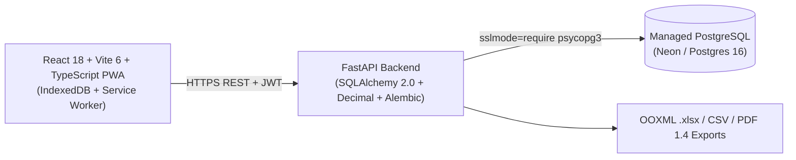

# FactoryFlow — Order-to-Audit Manufacturing ERP

**Order-to-Audit Manufacturing ERP connecting sales, GST billing, BOM-based production, inventory, costing, audit reporting, and offline PWA order synchronization.**

---

## 1. Project Overview
FactoryFlow is a production-grade ERP prototype tailored for Indian food & snack manufacturers. It enforces full batch-to-invoice financial and inventory traceability from supplier procurement and multi-version BOM manufacturing through state-aware GST invoicing, dispatch, customer payments, executive reporting, and offline field sales capture.

## 2. Problem Statement
Small and mid-sized manufacturing plants struggle with disconnected spreadsheets across floor production, raw material wastage, GST calculations, customer receivables, and field salesmen working in low-connectivity zones—resulting in inventory drift, uncosted wastage, duplicate orders, and non-reconciled audits.

## 3. Architecture Diagram


## 4. Technology Stack
- **Frontend**: React `18.3.1`, TypeScript `5.6.3`, Tailwind CSS `3.4`, Vite `6.4.6` (`Node >= 20.18.0`), Vitest `2.1.9`, custom Service Worker + IndexedDB (`factoryflow_offline_db`).
- **Backend**: Python `3.13`, FastAPI `0.115.6`, SQLAlchemy `2.0.36`, Alembic `1.14.0`, Pydantic v2 (`Decimal` & PostgreSQL `NUMERIC`), `psycopg[binary] 3.2.3`, bcrypt `4.2.1`, PyJWT `2.10.1`.
- **Cloud Targets**: Vercel (Frontend SPA + PWA), Render (FastAPI + Docker/Python), Neon (Managed PostgreSQL).

## 5. User Roles & Permissions
FactoryFlow enforces strict role-based separation of duties across the five canonical internship roles (retaining `qa_inspector` as an optional quality gate role):

| Role | Internal Key | Access Scope |
| :--- | :--- | :--- |
| **Factory Admin** | `admin` | Full governance, user/role provisioning, master data, order approvals, GST invoicing, dispatches, adjustments |
| **Factory Owner** | `owner` | Dedicated read-only executive oversight (`/owner` 15-KPI dashboard, margins, all 15 audit reports, `.xlsx`/`.csv`/`.pdf` exports, audit trail); cannot modify users, purchases, inventory, production, orders, or invoices |
| **Order & Production Manager (Salesman)** | `order_manager` | Assigned customers only, quick Mobile & Offline PWA orders, own order tracking |
| **Shop Floor Supervisor** | `floor_supervisor` | Purchases, Inventory receipts, Production execution & run expenses |
| **Compliance Auditor / Accountant** | `auditor` | Strictly read-only Finance/Auditor portals, all 15 audit reports & `.xlsx`/`.csv`/`.pdf` exports |
| **QA Inspector *(Optional)*** | `qa_inspector` | BOM verification, production quality & wastage inspection |

## 6. Features by Development Phase
- **Phases 1–2 (Core RBAC & Master Data)**: JWT authentication, 5 roles, immutable `audit_logs`, Products (`MUR-200`), Raw/Packaging `StockItem`s, Customers, Suppliers, and dimensional Unit Conversions.
- **Phase 3 (Purchases & Weighted-Avg Inventory)**: Append-only `StockLedger` (`before_update`/`before_delete` guards), `StockBalance`, multi-unit purchase posting/cancellation, negative-stock prevention.
- **Phase 4 (BOM & Production)**: Versioned BOM snapshots, batch scaling, consumed+damaged input issues, good packet output, carton capacity check, and `-/+` tolerance variance engine.
- **Phase 5 (Sales Orders, GST Invoices & Dispatch)**: Mobile order workflow, stock shortage holds (`AWAITING_STOCK`), intra-state `CGST+SGST` vs inter-state `IGST`, immutable GST Tax Invoices & PDFs, atomic dispatches.
- **Phase 6 (Costing, Overheads & Payments)**: Actual weighted-avg material cost + posted expenses (`Labour`, `Gas`, `Power`), pre-GST margin, customer payments, allocation dedup, Customer Ledger/Statement, 5-bucket ageing.
- **Phase 7 (Owner Dashboard & Audit Reporting)**: Owner Console (15 KPIs, 10 trends, alerts), Auditor Portal, 15 audit reports with historical `as_of_date` ledger reconstruction, `.xlsx`/`.csv`/`.pdf` exports.
- **Phase 8 (Offline PWA & Idempotent Sync)**: Web manifest, icons, SW shell cache (`/api/*` bypass), IndexedDB offline queue, auto-sync on launch/`online`, price conflict detection (`NEEDS_REVIEW`), `POST /api/v1/orders/sync` with unique `idempotency_key`.
- **Phase 9–10 (E2E Benchmark QA, PostgreSQL Verification & Cloud Deployment)**: Safety-guarded benchmark reset-and-seed CLI, **117** automated tests (**91** backend `pytest` + **26** frontend `vitest`), Alembic `0001`–`0008` (`owner` role + independent DB-backed report reconciliations + filtered purchase-register fix), GitHub Actions CI ([.github/workflows/ci.yml](.github/workflows/ci.yml)), Vercel + Render + Neon PostgreSQL deployment, 2-page PDF design note, and Stage 3 PostgreSQL benchmark acceptance report.

## 7. Installation & Local Run Instructions (Docker-Free)

### Backend Setup
```powershell
cd backend
python -m venv .venv
.\.venv\Scripts\python.exe -m pip install -r requirements.txt
Copy-Item .env.example .env   # Configure DATABASE_URL (Neon PostgreSQL) & SECRET_KEY
.\.venv\Scripts\python.exe -m alembic upgrade head
.\.venv\Scripts\python.exe -m scripts.seed --force-demo   # Optional: dummy demo accounts only
.\.venv\Scripts\python.exe -m uvicorn app.main:app --reload --port 8000
```

### Frontend Setup
```powershell
cd frontend
npm install
Copy-Item .env.example .env   # Uses /api/v1 proxy in dev or VITE_API_BASE_URL in production
npm run dev
```

### Optional Docker Compose Alternative
```bash
docker compose up --build
```

## 8. Environment & Security Implementation
- **Backend** ([backend/.env.example](backend/.env.example)): `DATABASE_URL`, `SECRET_KEY` (32+ random chars enforced on production startup), `ENVIRONMENT`, `CORS_ORIGINS`, `DEMO_SEED_ENABLED`, `DEMO_SEED_PASSWORD`. Real `.env`, `.env.*`, and credential files are excluded from Git via [.gitignore](.gitignore).
- **Frontend** ([frontend/.env.example](frontend/.env.example)): `VITE_API_BASE_URL` (pointing to deployed Render `/api/v1` endpoint; zero secrets stored in `VITE_*` variables or IndexedDB).
- **RBAC, Row Locking & Audit**: JWT auth + `bcrypt` password hashing, strict 5-role server permission matrix, append-only `StockLedger` (`before_update`/`before_delete` guards), PostgreSQL `SELECT ... FOR UPDATE OF` locking on stock allocations and payments, and immutable `audit_logs`.

## 9. Demo Login Accounts (Hosted Evaluation Only)
`DEMO_SEED_ENABLED` defaults to `false` in `.env.example` and `render.yaml`. Demo seeding requires a unique strong `DEMO_SEED_PASSWORD` (`scripts.seed` and startup checks block weak or public sample passwords in `ENVIRONMENT=production`). Never publish live passwords in Git or documentation — share evaluator credentials privately:
- **Factory Admin**: `admin@factoryflow.io` (`admin`)
- **Factory Owner (Read-Only)**: `owner@factoryflow.io` (`owner`)
- **Salesman A / Salesman B**: `orders@factoryflow.io`, `salesman_b@factoryflow.io` (`order_manager`)
- **Production Supervisor**: `floor@factoryflow.io` (`floor_supervisor`)
- **Accountant / Auditor**: `auditor@factoryflow.io` (`auditor`)
- **QA Inspector *(Optional)***: `qa@factoryflow.io` (`qa_inspector`)

## 10. Verified Manufacturing Benchmark Results (`Murukku 200 g`)
Isolated reset-and-seed command (guarded against running on production or main `DATABASE_URL`):
```powershell
cd backend
.\.venv\Scripts\python.exe -m scripts.benchmark_reset_seed --database-url sqlite:///./.benchmark_test_isolated.db
```
Verified end-to-end across **both isolated SQLite CI and live Neon PostgreSQL `16.16`** (`factoryflow-test` branch, selling price `₹50`, GST `5%`):
- **Flour**: `100 kg @ ₹42` + `60 kg @ ₹45` -> `160 kg @ ₹43.125/kg` (`₹6,900`); after `40 kg` issue -> **`120 kg`**.
- **Production**: `188` good packets (`-6%` yield), Oil `+5%` (`19.5 L`), Spice `3.8 kg`, Pouches `306`, Cartons `21` (`8 packets remain unpacked`), Finished Goods **`238` packets**.
- **Sales & Dispatch**: Retailer A `150` pkts -> Taxable `₹7,500`, CGST `₹187.50`, SGST `₹187.50`, Total `₹7,875` (`%PDF-1.4`); Dispatch leaves **`88` packets**; Distributor B (`120` pkts) held in `AWAITING_STOCK` with shortage **`32` packets** & `IGST 5%` (`₹300`) preview and billing blocked.
- **Costing & Payment**: Material+Pkg `₹4,055` + Labour `₹1,200` + Power/Gas `₹600` = **`₹5,855`** (`₹31.143617` exact / **`₹31.14`** display, profit `₹18.86`, margin **`37.71%`**); Payment `₹4,000` -> **`₹3,875` outstanding**.

## 11. Automated Tests & CI (`117` Tests Passing)
- **GitHub Actions CI** ([.github/workflows/ci.yml](.github/workflows/ci.yml)): Runs Alembic `upgrade head`, full backend `pytest`, frontend `vitest`, and `tsc -b && vite build` on `push`/`pull_request`.
```powershell
# Backend (91 tests across Phases 1–10 + filtered purchase regression, isolated SQLite)
cd backend
.\.venv\Scripts\python.exe -m pytest -v

# Frontend (26 tests across 9 Vitest files + production TypeScript/Vite build)
cd frontend
npm test
npm run build
```

## 12. Live Deployment, API Docs & Submission Artifacts
- **Public GitHub Repository**: `https://github.com/M-KESAVAN003/factoryflow-order-to-audit`
- **Live Frontend URL (Vercel)**: `https://factoryflow-order-to-audit.vercel.app` (`HTTP 200` verified)
- **Live Backend `/health` URL (Render)**: `https://factoryflow-api-g1eu.onrender.com/health` (`HTTP 200`, `{"status":"ok","service":"factoryflow-api","database":"connected"}`)
- **Live Swagger API Docs**: `https://factoryflow-api-g1eu.onrender.com/docs` (`HTTP 200` verified)
- **Design Note (`2` Pages)**: [docs/DESIGN.md](docs/DESIGN.md) & [docs/DESIGN.pdf](docs/DESIGN.pdf)
- **Demo Script (`<= 8` Min)**: [docs/DEMO_SCRIPT.md](docs/DEMO_SCRIPT.md) *(Demo Video URL & Screenshots: `<Pending manual screen recording>`)*
- **Verification & Submission Docs**: [docs/STAGE3_POSTGRES_ACCEPTANCE_REPORT.md](docs/STAGE3_POSTGRES_ACCEPTANCE_REPORT.md), [docs/FINAL_QA_REPORT.md](docs/FINAL_QA_REPORT.md), [docs/PHASE9_FINAL_VERIFICATION.md](docs/PHASE9_FINAL_VERIFICATION.md), [docs/OFFLINE_PWA.md](docs/OFFLINE_PWA.md), [docs/SUBMISSION_CHECKLIST.md](docs/SUBMISSION_CHECKLIST.md).

## 13. Known Limitations, Pending Security Actions & Future Improvements
- **Verification Scope**: Backend, frontend, live Render/Vercel connectivity, and the complete 10-step Stage 3 benchmark on isolated Neon PostgreSQL (`factoryflow-test`) are verified; **physical Android Chrome offline PWA execution remains `NOT VERIFIED`**, and **production Neon DB password & Render `SECRET_KEY` rotation remains `PENDING`** prior to public evaluator handover. Offline quick orders store one SKU per local queue entry, and GST reports are internal accounting summaries rather than GSTN portal filings.
- **Future Improvements**: Multi-line offline cart in PWA IndexedDB, automated Playwright Chromium + PostgreSQL service containers in CI, e-Way bill / GSP API integration, and automated supplier payables ledger.
