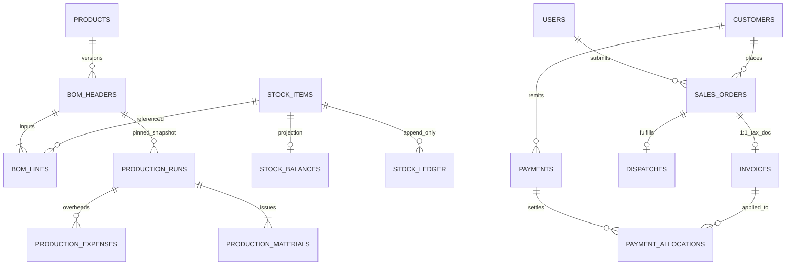

# FactoryFlow — Two-Page System Design Note

## 1. Architecture Overview & Technology Stack
FactoryFlow is an Order-to-Audit Manufacturing ERP unifying sales ordering, GST invoicing, BOM production, weighted-average inventory, costing, payments, and executive audit reporting.
- **Frontend**: React 18, TypeScript, Tailwind CSS 3, Vite 6, IndexedDB + Service Worker PWA (`frontend/public/sw.js`).
- **Backend**: Python 3.13, FastAPI, SQLAlchemy 2.0 (`Decimal` + `NUMERIC`), Pydantic v2, Alembic (`0001`–`0007`).
- **Database**: Persistent PostgreSQL (Neon / managed PG with `sslmode=require` via `psycopg` v3).

## 2. Core Entity Relationship Diagram

## 3. Append-Only Stock Ledger & Weighted-Average Valuation
- **Immutability**: `stock_ledger` enforces append-only integrity via SQLAlchemy `before_update` and `before_delete` hooks (`REVERSAL` entries offset mistakes). Every row stores `reference_doc_type`, `reference_doc_id`, `quantity_in`/`out`, `unit_cost`, `balance_qty_after`, `avg_cost_after`, and `balance_value_after`.
- **Weighted-Average Cost**: On receipt (`PURCHASE_RECEIPT` / `PRODUCTION_OUTPUT`), $\text{Avg Cost} = \frac{\text{Old Value} + \text{Receipt Value}}{\text{Old Qty} + \text{Receipt Qty}}$. Benchmark: `100 kg @ ₹42 + 60 kg @ ₹45 = ₹6,900 / 160 kg = ₹43.125/kg`. Historical cut-off reports (`as_of_date`) reconstruct balances directly from `stock_ledger`.

## 4. BOM Consumption & Production Variance
- **BOM Snapshot**: `production_runs` pins `bom_id` + `bom_version_snapshot`; activating a new BOM version never alters historical runs.
- **Consumption & Output**: `total_consumed_base_qty = actual_quantity + damaged_quantity` (benchmark: `188 + 6 = 194` pouches). Only `actual_good_output` (`188` packets) posts to Finished Goods.
- **Variance**: $\frac{\text{Actual} - \text{Planned}}{\text{Planned}} \times 100$ against `3%` tolerance (`GREEN`, `ORANGE`, `RED`). Benchmark yields: `-6%` output (`188 vs 200`), `+5%` oil (`10.5 vs 10`), `-3%` pouches (`194 vs 200`), `-10%` cartons (`9 vs 10`, leaving `8` packets unpacked).

## 5. Production Costing & GST Calculation
- **Costing (`Decimal`)**: Combines actual issued raw materials (`Flour ₹1,725 + Oil ₹1,470 + Spice ₹240 = ₹3,435`), packaging (`194×₹2.50 + 9×₹15 = ₹620`), and posted overheads (`Labour ₹1,200 + Gas ₹600 = ₹1,800`) = `₹5,855` -> `₹31.143617/pkt` (`₹31.14` display), pre-GST profit `₹18.86`, margin `37.71%`.
- **GST Determination**: Compares factory state (`Tamil Nadu`) vs customer state. Intra-state splits 5% equally (`2.5% CGST + 2.5% SGST` -> `₹7,500 + ₹187.50 + ₹187.50 = ₹7,875`); inter-state charges `5% IGST`. Posted invoices are immutable; dispatch independently deducts finished stock (`238 -> 88` pkts).

## 6. Payment Allocation & Immutable Audit Trail
- **Payments & Receivables**: `payments` and `payment_allocations` enforce unique `(payment_id, invoice_id)`, prevent over-allocation, and sum only `POSTED` allocations (`₹7,875 - ₹4,000 = ₹3,875` outstanding across 5 ageing buckets).
- **Audit Trail**: Every login, CRUD action, stock post/adjustment, BOM/production change, invoice/dispatch/payment, and offline sync replay (`idempotency_key`) logs actor, role, resource ID, timestamp, and IP to immutable `audit_logs`.
